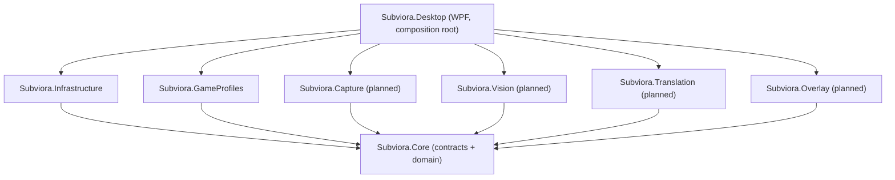
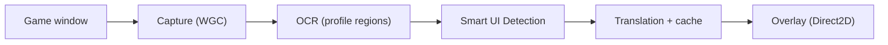

# Subviora Architecture

Status: **AG-01 (foundation)**. This document describes the approved architecture, what exists today,
and the boundaries future stages must respect. Sections marked *planned* are not implemented.

## 1. Goals and constraints

- Real-time English → Turkish translation of video game subtitles on Windows 10/11 x64.
- Offline-first: the default pipeline must work without network access.
- Minimal gaming performance impact: no injection into game processes, no graphics API hooking.
- Premium native Windows experience; commercial distribution (Steam planned).
- Standard user rights only; no administrator elevation without a demonstrated requirement.
- Replaceable OCR and translation providers.

## 2. Solution layout

```
Subviora.sln
├─ src/
│  ├─ Subviora.Core            net10.0          Domain models + module contracts. No dependencies.
│  ├─ Subviora.Infrastructure  net10.0          Paths, configuration, validation, logging (→ SQLite later).
│  ├─ Subviora.GameProfiles    net10.0          Profile JSON schema v1, validation, file-system store.
│  ├─ Subviora.Capture         net10.0-windows  (planned) Windows Graphics Capture provider. Empty.
│  ├─ Subviora.Vision          net10.0          (planned) OCR + Smart UI Detection providers. Empty.
│  ├─ Subviora.Translation     net10.0          (planned) Offline/online translation providers. Empty.
│  ├─ Subviora.Overlay         net10.0-windows  (planned) Win32 + Direct2D/DirectWrite overlay. Empty.
│  └─ Subviora.Desktop         net10.0-windows  WPF management app; composition root. Output: Subviora.exe
├─ tests/
│  └─ Subviora.Tests           net10.0          xUnit v3 unit + architecture tests.
└─ profiles/
   ├─ builtin/                 Built-in game profiles (shipped read-only next to the executable).
   └─ schema/                  JSON Schema for profile documents.
```

The four *planned* module projects intentionally contain only a project file and a README describing
their boundary. AG-01 contains **no fake implementations** of capture, OCR, classification,
translation or overlay.

## 3. Dependency rules



1. `Subviora.Core` references nothing (BCL only). Contracts use only BCL types.
2. Module projects reference `Subviora.Core` only — never each other, never `Infrastructure`.
3. `Subviora.Infrastructure` references `Subviora.Core` only.
4. `Subviora.Desktop` is the single composition root that wires implementations to contracts.
5. Third-party packages stay at the edges (Infrastructure, Desktop, or the module that needs them).

Rules 1–3 are enforced by `tests/Subviora.Tests/Architecture/DependencyRuleTests.cs`.

## 4. Module contracts (`Subviora.Core`)

| Contract | Namespace | Purpose | Planned implementation |
|---|---|---|---|
| `IScreenCaptureProvider` | `Core.Capture` | Capture a frame from a game window (HWND). | Windows Graphics Capture (D3D11) |
| `IOcrProvider` | `Core.Vision` | Recognise text lines (normalized bounds + confidence). | Replaceable OCR engines |
| `IUiClassificationProvider` | `Core.Vision` | Classify lines as Subtitle / Menu / HUD / … | Hybrid Smart UI Detection |
| `ITranslationProvider` | `Core.Translation` | Translate text; reports `IsOffline`. | Offline engine (default), optional online |
| `IOverlayRenderer` | `Core.Overlay` | Show / clear translated subtitles. | Win32 layered window + Direct2D/DirectWrite |
| `IGameProfileProvider` | `Core.Profiles` | Resolve profiles by id or executable. | `FileSystemGameProfileProvider` (**implemented**) |

All asynchronous operations take a `CancellationToken`. The `CapturedFrame` shape (CPU BGRA32 buffer)
is provisional; a GPU-resident frame type may be introduced when the capture pipeline is built.
No pipeline/orchestrator abstraction exists yet by design — it will be designed in AG-02+ together
with the first real capture implementation, based on measured requirements.

## 5. Application lifecycle (`Subviora.Desktop`)

`App.OnStartup` runs these steps in order; any failure produces a logged, user-visible Turkish error
dialog and a non-zero exit code:

1. **Single instance** — named mutex `Local\Subviora.Desktop.SingleInstance`.
2. **Data directories** — `AppPaths.CreateDefault()` → `%LOCALAPPDATA%\Subviora\{Logs,Config,Profiles,Cache}`
   (override root with `SUBVIORA_DATA_DIR` for testing).
3. **Configuration** — `appsettings.json` (shipped) → `Config\settings.json` (user, optional) →
   `SUBVIORA_*` environment variables. Bound with `ErrorOnUnknownConfiguration` and validated by
   `SubvioraOptionsValidator`. Invalid configuration stops startup with the list of errors.
4. **Logging** — Serilog, compact JSON (CLEF), daily rolling + size limit, retention from config,
   exposed through `Microsoft.Extensions.Logging`.
5. **Host + DI** — `Host.CreateEmptyApplicationBuilder`, `ValidateOnBuild`/`ValidateScopes`, options
   `ValidateOnStart`, a desktop `IHostLifetime` (WPF owns the process lifetime).
6. **UI** — `MainWindow` resolved from DI; tray icon (`NotifyIcon`) if enabled.

Shutdown (`OnExit`): stop host (5 s timeout) → dispose container (tray icon) → flush logs → release mutex.

### Exception handling

| Source | Behaviour |
|---|---|
| UI thread (`DispatcherUnhandledException`) | Log critical → error dialog → orderly shutdown (exit code 1). |
| Background thread (`AppDomain.UnhandledException`) | Log critical; flush logs if terminating. |
| Unobserved tasks | Log error, then mark observed. |
| Fire-and-forget UI tasks | `Task.SurfaceExceptions()` re-raises faults on the dispatcher → global handler. |
| Expected I/O failures (profiles, folders) | Logged and shown inline / in a dialog. |

The fatal-error path depends only on BCL/WPF/`Microsoft.Extensions.Logging.Abstractions`, so even if a
Subviora assembly cannot be loaded (e.g. blocked by Smart App Control) the user receives an explanation.

## 6. Game profiles

- Schema: `profiles/schema/game-profile.v1.schema.json` (`schemaVersion: 1`).
- Coordinates: normalized to the game client area, `(0,0)` top-left → `(1,1)` bottom-right;
  `referenceWidth/Height` record the authoring resolution (informational).
- Fields: game id, executables, languages, coordinate space, calibration status/notes, subtitle regions,
  exclusion regions, overlay preferences, profile version.
- Reading: `GameProfileSerializer` gates on `schemaVersion` first, rejects unknown properties, maps to the
  domain model, then `GameProfileValidator` applies semantic rules. Malformed files never throw; they are
  reported as `ProfileLoadIssue`s.
- Storage: built-in profiles ship read-only in `<install>\profiles\builtin`; user profiles live in
  `%LOCALAPPDATA%\Subviora\Profiles`. User profiles are layered overrides: built-in profiles remain
  immutable, while user files specify only customized fields and region operations (`replace`, `upsert`,
  `remove`). Updates to built-in profiles continue to flow through without wiping user customizations.
  Profiles with wildcard `*` executables provide Universal Mode fallback. Built-in files are never written.
- The GTA V profile is an **uncalibrated example**; its regions are not verified gameplay coordinates.

## 7. Planned runtime pipeline (not implemented)



Implementation boundaries for future stages:

- Capture and overlay must not inject into or hook the game process.
- Frame processing must be off the UI thread; the WPF window is a management UI only.
- The overlay is a separate native window, not WPF.
- Online translation is opt-in, uses user-provided credentials stored outside the repository, and is
  never required for core functionality.
- Model weights are never committed; acquisition and licensing are handled per provider.
