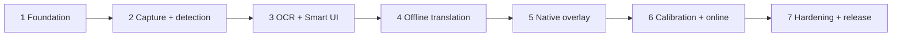

# Roadmap

Subviora is delivered in seven stages. Each stage is broken into AG tasks; every AG task ends with
a validated commit pushed to `develop`. The stage numbers here are the ones shown in the
application's placeholder pages (for example, "Yol haritası: Aşama 4" on the Translation page).

| Stage | Name | Status |
|---|---|---|
| 1 | Foundation | **In progress: AG-01 delivered** |
| 2 | Capture and game detection | Planned |
| 3 | OCR and Smart UI Detection | Planned |
| 4 | Offline translation and cache | Planned |
| 5 | Native subtitle overlay | Planned |
| 6 | Calibration tooling and optional online providers | Planned |
| 7 | Performance, signing, installer and Steam release | Planned |

## Stage 1: Foundation (AG-01)

Delivered in AG-01:

- Solution structure, module boundaries and dependency rules (verified by tests).
- WPF management shell: dark theme, Turkish UI, navigation, honest status for features that are not implemented.
- Lifecycle: single instance, dependency injection (generic host), configuration loading and validation,
  structured logging, global exception handling, per-user data directories, tray icon.
- Module contracts: capture, OCR, UI classification, translation, overlay renderer, game profile provider.
- Game profile schema v1, loader and validator, user overrides, and an uncalibrated GTA V Story Mode sample.

Remaining foundation work, to be scheduled with stage 2: CI pipeline, application icon asset, and
localization resources.

## Stage 2: Capture and game detection

- Detect supported games by executable name (from the profiles) and track their window.
- `IScreenCaptureProvider` implementation using Windows Graphics Capture (Direct3D 11 frames).
- Handle window resize, minimise, monitor change, DPI change, and borderless and exclusive fullscreen.
- Measure capture overhead and keep it within the frame budget.

## Stage 3: OCR and Smart UI Detection

- First `IOcrProvider` implementation (offline, with a license suitable for commercial use).
- Region cropping from profile subtitle regions; exclusion regions applied.
- `IUiClassificationProvider`: a hybrid of profile rules and heuristics (position, stability, timing,
  styling) to separate subtitles from HUD, menu and phone text.
- Subtitle change detection, so unchanged text is not re-processed.

## Stage 4: Offline translation and cache

- First offline `ITranslationProvider` (English to Turkish). Model weights are downloaded or installed
  separately and are never committed to the repository.
- SQLite translation cache in `%LOCALAPPDATA%\Subviora\Cache`.
- Translation page becomes functional (provider status, cache statistics).

## Stage 5: Native subtitle overlay

- `IOverlayRenderer` implemented with Win32 and Direct2D/DirectWrite: a layered, click-through window
  that does not take focus.
- Applies profile overlay preferences (position, font scale, background opacity).
- Overlay page becomes functional.

## Stage 6: Calibration tooling and optional online providers

- In-app region calibration and profile editor; user overrides written to the user profile directory.
- Settings editing in the UI.
- Optional, opt-in online translation providers. API keys are stored per user with Windows DPAPI, never
  in the repository.
- Calibrated, verified GTA V Story Mode profile.

## Stage 7: Performance, signing, installer and Steam release

- Performance hardening: CPU and GPU budget, latency targets, long-session stability.
- Authenticode code signing for all binaries (this is also required for Smart App Control compatibility).
- Installer and update strategy; Steamworks integration and Steam distribution.
- Broader game compatibility beyond GTA V.
